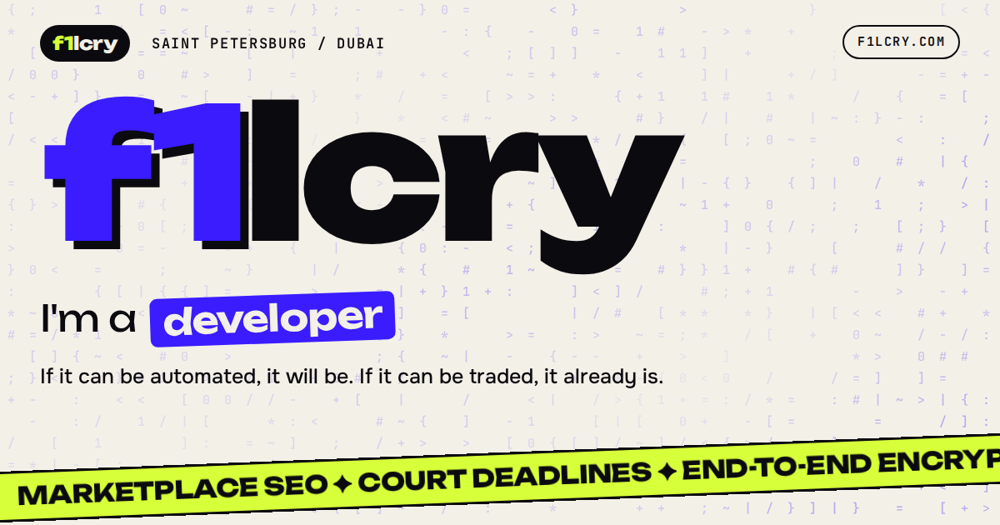

# Hey, I'm Philipp 👋

Software engineer in Dubai. I build data-heavy backends, LLM pipelines and native macOS apps.
HSE University · writing code since 2021 · 5+ years in markets.

---

### Now

**Software engineer at a Dubai cross-border e-commerce company**, building the catalog, pricing and supplier-data backbone behind its marketplace stores. Stack: FastAPI · SQLAlchemy 2 async · PostgreSQL · arq/Redis · React/TS.

- **LLM product matching.** Replaced a hand-configured matcher, which was blind to 73% of the catalog (recall 0.52 at 0.997 precision), with a six-stage pipeline: GTIN pre-pass → typed identity extraction → retrieval over ~42k catalog cards → LLM adjudication → deterministic guards. On a brand-disjoint holdout it reaches **0.95 recall at 0.97 precision** with no per-vertical configuration, and model cost fell **11×**. Every change has to pass a ground-truth replay harness, with a negative-control gate that the defect tests must fail on the old code.
- **Supplier data service, built and run solo.** 10+ price and stock feeds on a 4×/day cycle, with first-party APIs replacing scraping wherever possible.
- **Resumable bulk imports.** Catalog imports of 60k+ rows run as background jobs with Redis leases, durable cancel and resume, and phased ingest → pricing → push, so a deploy no longer kills them.
- **Platform safeguards.** A 30-check data-consistency "doctor", a cost-change quarantine across 8 write paths, and a price policy enforced at both enqueue and push.

---

### Featured projects

| Project | What it is · what was hard | Stack |
|---|---|---|
| [**NotchGram**](https://github.com/f1lcry/notchgram) | Unofficial Telegram client that lives in the MacBook notch. Built on Swift 6 strict concurrency over TDLib (direct MTProto, no backend), with a custom non-activating panel engine that also works over full-screen Spaces. I traced a 13 GB main-thread livelock to per-message publishes (now flat at ~200 MB) and a fast-scroll crash to SwiftUI `VideoPlayer` aborting on macOS 26.6. 10.5k LOC, 120+ tests, 45 recorded design decisions. Notarized DMG, Sparkle updates, `brew install --cask f1lcry/tap/notchgram`. | `Swift 6` `SwiftUI/AppKit` `TDLib` `Sparkle` |
| [**Dictate**](https://github.com/f1lcry/dictate-releases) | On-device dictation and meeting transcription for macOS: Whisper large-v3-turbo on the Neural Engine plus on-device speaker diarization. I root-caused a WhisperKit word-timestamp bug (alignment attention read at the wrong KV-cache rows), which took speaker attribution from **46.7% to 90.5%**. Crash-safe dual-format recording through a Core Audio tap, Ed25519 licensing on Cloudflare Workers + D1. 16k LOC, 320+ tests, 7 notarized releases. | `Swift 6` `WhisperKit` `CoreML` `Cloudflare Workers` |
| [**CleanSpeechBot**](https://github.com/f1lcry/CleanSpeechBot) | Telegram bot that turns a voice message into a cleaned-up summary with zero external API calls: Whisper + Llama 3.1 8B via Ollama, an asyncio worker queue to bound CPU, and nothing persisted. | `Python` `aiogram 3` `Whisper` `Ollama` `Docker` |
| [**mpp-core**](https://github.com/f1lcry/mpp-core) | MVP pipeline from 1688 to Ozon in ports-and-adapters layers: TMAPI ingestion, an Ozon Seller API client (category and attribute lookup, import, status polling), and a SQLite status machine from `new` to `exported`. Standard-library Python only. | `Python` `Ozon Seller API` `SQLite` |

---

### Private / NDA work

| Project | What I built · measured result | Role |
|---|---|---|
| [**Dosrok**](https://dosrok.ru) · AI legal-deadline platform (closed pilot) | Calendar that computes procedural deadline chains for Russian litigators. The rules engine is data, not code: YAML across 5 procedural codes plus the production calendar. Court scans run through OCR → LLM extraction, with personal data masked on the image before any model sees it and every field cross-checked against OCR. On a 50-document golden set: **97.4%** of dates correct and **0** confident-but-wrong results. Also court-case monitoring, a Telegram bot interface and ICS feeds. ~600 tests. `Django 6` `Postgres` `aiogram` `OpenRouter` | Founder · sole engineer |
| [**Мой SEO**](https://moyseo.com) (production) | Ad automation SaaS for Wildberries sellers: a search-cluster guard, an AI keep/cut classifier with a human review queue, automatic bidding, and a tool-calling agent that proposes write actions and runs them only after operator confirmation. Store credentials are encrypted per store (MultiFernet, rotatable), and a Celery watchdog runs in prod. ~800 tests. `Django/DRF` `Celery` `React 19` `TS` | Founder · lead engineer |
| **Self-hosted agent orchestration** | Personal infrastructure that runs a fleet of Claude Code agents on a VPS, driven from a phone over Telegram. A task queue spawns a lead per task; a tool-call guard limits what leads can do, workers run in isolated tmux sessions, and context rotates automatically. It also includes local Whisper STT and [Sotto](https://sotto.f1lcry.com), private calls on my own server that are end-to-end encrypted in the browser (ECDH P-256 → HKDF → AES-GCM). Access is WireGuard-only and secrets never enter git. **285 tasks closed** in its first month, ~2.9k tests. `Python` `systemd` `Caddy` `WireGuard` | Sole engineer |
| **Teamy** · AI team assistant for Telegram (case project, no longer active) | Chat analysis, meeting and voice summaries, spec generation. 100+ users, paid subscriptions, finalist at a Moscow case championship. I rewrote v2 from scratch: OpenRouter with a fallback model chain per feature, local faster-whisper, Robokassa billing, 180 tests. | CTO · Team Lead |
| **Multi-tenant e-commerce CRM** (MVP) | Operator CRM for importing from 1688: hourly price and stock sync, pricing templates, a 7-state order machine, an HMAC-signed idempotent storefront API, an LLM tool-calling assistant streamed over SSE, and one isolated stack per tenant behind Caddy. 450+ tests, CI. `Django/DRF` `Celery` `React/TS` | Lead engineer, with a business partner |
| **Algorithmic trading** | Systematic strategies taken from hypothesis to live execution on real capital: backtests, risk limits, exchange-API execution, monitoring. The real skill is honest rejection. One example is a fair-value-gap lab (backtester, Bybit execution runner, Telegram notifier, fixed-fractional sizing): it was retired on paper because its edge did not survive costs. | Solo developer |
| **Web automation** | High-complexity Selenium system with anti-detect browsers, proxy rotation and behavioral automation. Team of 4. | Team Lead |
| **Crypto bank & exchange** | Banking and exchange infrastructure for LATAM: financial modeling, architecture, strategic development. | CTO · Finance Lead |
| **Web3 ecosystem** | ERC-20 token on Ethereum, listed on Bitget, with a custom NFT marketplace. 15K+ artist community, peak market cap ~$6M. | Founder |

---

### How I work

AI-native, with the rigor on my side. I write the spec and the acceptance gate (golden sets, negative-control tests, adversarial reviews, release gates), and coding agents do most of the typing. Most of my 2026 repos are 60–80% agent co-authored, and every engineering metric on this page comes from a test harness or production data.

---

### Tech stack

---

### GitHub Stats

---

### Contributions

<picture>
  <source media="(prefers-color-scheme: dark)" srcset="https://raw.githubusercontent.com/f1lcry/f1lcry/output/github-snake-dark.gif" />
  <source media="(prefers-color-scheme: light)" srcset="https://raw.githubusercontent.com/f1lcry/f1lcry/output/github-snake.gif" />
  
</picture>

---

*Building things that make money or save time — preferably both.*

